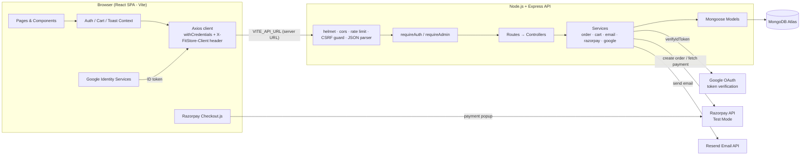
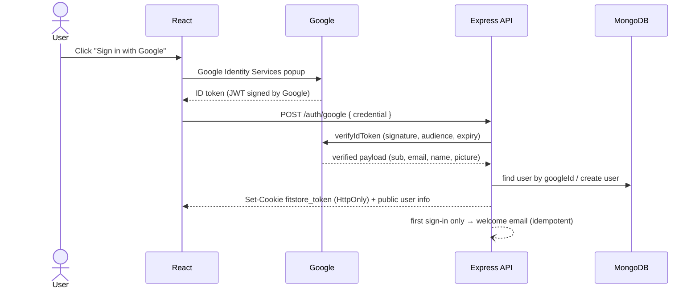
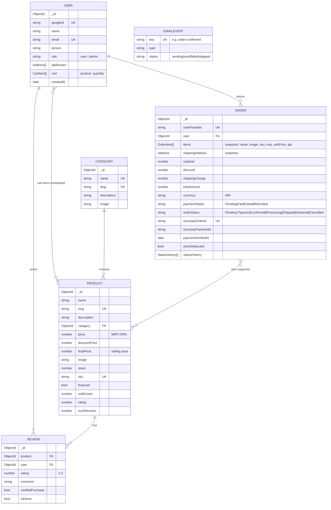
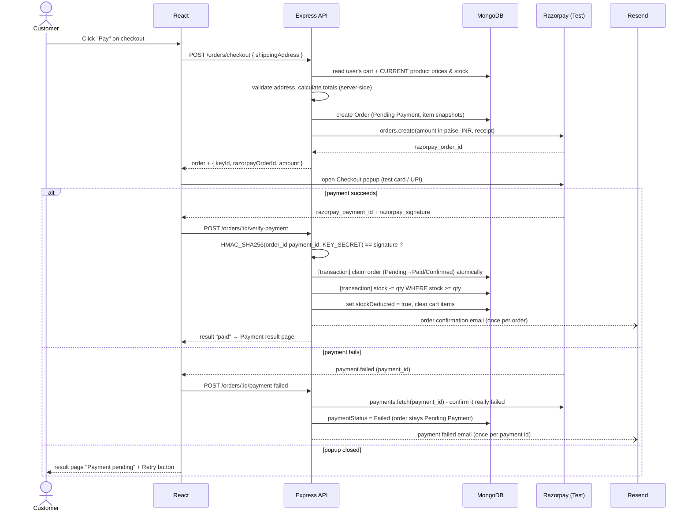
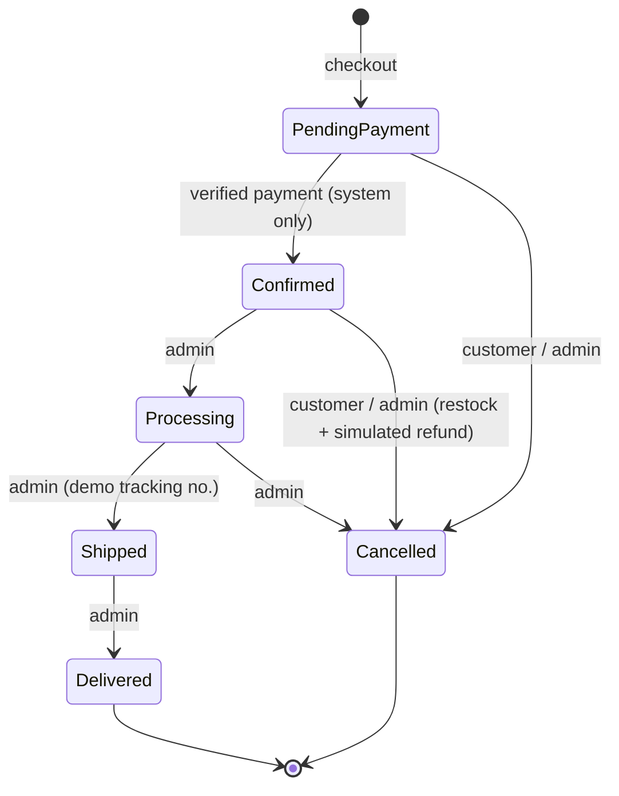
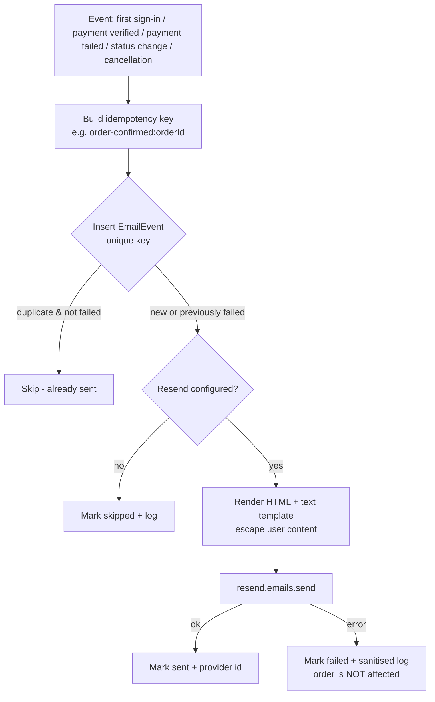

# FitStore — Project Documentation

## 1. Project Title

**FitStore: A Secure Online Fitness Products E-Commerce Website using the MERN Stack**

Tagline: *Fuel Your Fitness Journey.*

---

## 2. Abstract

FitStore is a full-stack web application for buying fitness products online: gym equipment, supplements, fitness accessories, sportswear, sports shoes, and yoga and recovery gear.

- **Frontend:** a responsive single-page application built with React and Vite.
- **Backend:** a REST API built with Node.js and Express.
- **Database:** MongoDB Atlas, accessed through Mongoose.
- **Sign-in:** Google Sign-In only. The Google ID token is verified on the server, and the session is a JWT stored in an HttpOnly cookie.
- **Payments:** Razorpay in **test mode**. Payments are verified on the server with an HMAC-SHA256 signature before an order is marked as paid.
- **Emails:** transactional emails are sent through Resend.
- **Admin panel:** product management, order management and sales statistics.

The project focuses on secure e-commerce practice:

- Prices and totals are calculated on the server.
- Payment processing is idempotent.
- Stock is updated atomically.
- Every protected API checks the user's role.
- Duplicate emails and repeated payment confirmations are prevented.

The system has 37 automated tests, including integration tests against a real MongoDB instance.

---

## 3. Problem Statement

Fitness shoppers often have to visit several shops or websites to buy equipment, nutrition and apparel. Many small online stores also have security weaknesses:

- They trust prices sent by the browser.
- They mark orders as paid based on a client-side message.
- They deduct stock twice when a payment callback repeats.
- They hide admin features only in the user interface.

A student project that shows how to build an online store **correctly and securely** — while staying simple enough to explain — is therefore valuable.

---

## 4. Objectives

1. Build a responsive, attractive store for six categories of fitness products.
2. Provide password-less sign-in with Google, verified on the server.
3. Implement a persistent shopping cart with stock limits and server-calculated totals.
4. Integrate Razorpay (test mode) with server-side signature verification.
5. Make payment processing idempotent: no double stock deduction and no duplicate emails.
6. Send transactional emails for key account and order events.
7. Provide an admin panel with role-based access control.
8. Allow product reviews with one review per user per product.
9. Write automated tests for authentication guards, pricing, signatures and order and payment safety.

---

## 5. Scope

**In scope:**
- Product catalogue with search, filters, sorting and pagination.
- Google sign-in, cart, checkout and test payments.
- Orders and order history, cancellation and payment retry.
- Transactional emails, an admin dashboard, product CRUD and the order status workflow.
- Reviews and the information/policy pages.

**Out of scope (simulated or not implemented):**
- Live payments and real refunds (refunds are simulated).
- Courier integration (tracking numbers are simulated).
- Image uploads, coupons and a wishlist.
- Multiple vendors and inventory across several warehouses.

---

## 6. Existing System and Proposed System

### Existing system (typical small online stores or manual selling)

- Orders are taken by phone or social media and tracked manually.
- No real-time stock tracking, so customers can buy items that are out of stock.
- Payment confirmation is checked by hand, or the site trusts the browser's "success" message.
- Passwords are stored by the site, which means more risk and more support work (password resets).
- No consistent order status updates for customers.

### Proposed system (FitStore)

| Problem | FitStore solution |
|---|---|
| Manual order tracking | Orders stored in MongoDB with a status history timeline |
| Over-selling | Stock is checked at checkout and deducted atomically after payment |
| Fake payment confirmation | The Razorpay signature is verified on the server with the secret key |
| Duplicate processing | An atomic "claim" update, a `stockDeducted` flag, MongoDB transactions and unique email keys |
| Password risk | Google Sign-In only; no passwords are stored |
| No customer updates | Automatic emails on confirmation, failure, status change and cancellation |
| Admin features hidden only in the UI | The JWT **and** the database role are checked on every admin API |

---

## 7. Functional Requirements

| ID | Requirement |
|---|---|
| FR1 | Users can browse products by category, search, filter by price and stock, sort and paginate. |
| FR2 | Users can view product details, reviews and related products. |
| FR3 | Users sign in only with Google; the server verifies the ID token. |
| FR4 | Signed-in users can add, update and remove cart items, limited by stock (max 10 per item). |
| FR5 | The cart shows subtotal, discount, shipping and total, all calculated on the server. |
| FR6 | Users can check out with a validated address and pay through Razorpay (test mode). |
| FR7 | An order becomes "Paid/Confirmed" only after server-side payment signature verification. |
| FR8 | Failed or abandoned payments leave the order "Pending Payment"; the customer can retry. |
| FR9 | Users can view their own orders and cancel orders that are pending payment or confirmed. |
| FR10 | The system sends welcome, confirmation, payment-failure, status-update and cancellation emails. |
| FR11 | Admins can view dashboard statistics (revenue from verified payments only). |
| FR12 | Admins can create, edit and delete products and manage stock. |
| FR13 | Admins can list, search and filter orders and update their status through allowed transitions. |
| FR14 | Users can post one review per product; the average rating is recalculated. |
| FR15 | Users can save and delete delivery addresses. |

## 8. Non-Functional Requirements

| Category | Requirement |
|---|---|
| Security | Google token verification, HttpOnly/SameSite cookie, CSRF header check, helmet headers, CORS limited to the client URL, rate limiting, input validation, regex escaping, HTML escaping in emails, secrets kept only on the server. |
| Reliability | Idempotent payment handling; transactions where supported; email failures never affect orders. |
| Performance | Indexed fields (slug, SKU, category, finalPrice, order status); pagination; lean queries. |
| Usability | Responsive layout (mobile, tablet, desktop); loading, empty and error states; toast notifications. |
| Accessibility | Labelled form fields, keyboard focus styles, skip link, ARIA labels on icon buttons, `aria-live` toasts. |
| Maintainability | Separate folders for routes, controllers, services, models, middleware and utilities; one shared API client in React. |
| Testability | The Express app is exported separately from `server.js`; external services are wrapped so they can be mocked. |

---

## 9. Technology Stack

| Layer | Technology | Why |
|---|---|---|
| UI | React 18 + Vite 6 | Component-based UI and a fast dev server |
| Routing | React Router 7 | Client-side routes, protected routes |
| HTTP | Axios | Interceptors for cookies, headers and error handling |
| State | Context API | Auth, cart and toasts — simple, without Redux |
| Styling | Plain CSS with variables | Easy to understand; consistent design tokens |
| Icons | lucide-react | Lightweight SVG icons |
| Server | Node.js 20 + Express 4 | Simple, popular REST framework |
| Database | MongoDB Atlas + Mongoose 8 | Flexible documents, schemas and validation, transactions |
| Auth | Google Identity Services, google-auth-library, jsonwebtoken | No passwords; verified identity |
| Payments | Razorpay Checkout + Node SDK | Popular Indian gateway with a full test mode |
| Email | Resend SDK | Simple transactional email API |
| Security | helmet, cors, express-rate-limit, cookie-parser | Standard Express security middleware |
| Testing | node:test, supertest, mongodb-memory-server | Built-in runner; tests against a real database |

---

## 10. System Architecture

**Layers**
- **Routes** map URLs to controllers and attach middleware such as `requireAuth`, `requireAdmin` and rate limiters.
- **Controllers** read the request, call services and send JSON.
- **Services** hold the business logic: pricing, checkout, payment finalisation, cancellation and emails.
- **Models** define the MongoDB schemas, validation and indexes.
- **Middleware** handles authentication, CSRF and errors.

---

## 11. Data Flow

### 11.1 Browsing

`React page → GET /products?filters → productController builds a safe MongoDB query (escaped regex, whitelisted sort) → paginated JSON → ProductGrid`

### 11.2 Sign-in

### 11.3 Cart

`Add to cart → POST /cart/items → stock & max-quantity check → user.cart updated → server recalculates totals from current product prices → React shows the totals it received`

---

## 12. Database Schema and Relationships

**Design decisions**
- **Embedded cart.** The cart is stored inside the user document. It is a small list that always belongs to one user, so a single read returns it.
- **Snapshots in orders.** Each order stores the product name, image and price paid at checkout. Old orders stay correct even if a product is later edited or deleted.
- **`finalPrice`** is stored in the product (updated on save), so price filters and sorting are simple indexed queries.
- **Unique indexes** prevent duplicates: one review per (product, user), and unique SKU, slug, order number, Razorpay order ID and email key.

---

## 13. API Overview

| Module | Endpoints |
|---|---|
| Auth | `POST /auth/google`, `GET /auth/me`, `POST /auth/logout` |
| Products | `GET /products`, `GET /products/:idOrSlug`, `POST /products`*, `PUT /products/:id`*, `DELETE /products/:id`* |
| Reviews | `GET /products/:id/reviews`, `POST /products/:id/reviews` |
| Categories | `GET /categories` |
| Cart | `GET /cart`, `DELETE /cart`, `POST /cart/items`, `PATCH /cart/items/:productId`, `DELETE /cart/items/:productId` |
| Orders | `POST /orders/checkout`, `GET /orders/my`, `GET /orders/:id`, `POST /orders/:id/verify-payment`, `POST /orders/:id/payment-failed`, `POST /orders/:id/retry-payment`, `POST /orders/:id/cancel` |
| Addresses | `GET/POST /users/addresses`, `DELETE /users/addresses/:addressId` |
| Admin* | `GET /admin/dashboard`, `GET /admin/orders`, `PATCH /admin/orders/:id/status` |
| Misc | `GET /health`, `GET /config` |

\* admin only.

**Response format:**
- Success: `{ success: true, data, pagination?, message? }`
- Error: `{ success: false, message, details? }`

**Status codes:**
- 200/201 — success
- 400 — validation error
- 401 — not signed in
- 403 — forbidden
- 404 — not found (also returned for orders owned by someone else, so their existence is not revealed)
- 409 — conflict (stock or duplicate)
- 429 — rate limited
- 502 — payment gateway error

---

## 14. Authentication and Payment Workflow

### 14.1 Authentication and authorisation

1. Google returns an **ID token**. The server verifies it with `OAuth2Client.verifyIdToken({ idToken, audience: GOOGLE_CLIENT_ID })` and requires `email_verified`.
2. The server signs its own JWT `{ sub: userId }` (HS256, 7 days) and sets it as an **HttpOnly** cookie: `SameSite=Lax` in development, and `SameSite=None; Secure` in production (the client on Vercel and the API on Render are different sites). JavaScript cannot read it, which protects it from XSS theft.
3. `requireAuth` verifies the JWT and **loads the user from the database**. The role is never taken from the token or the request, so promoting or demoting an admin applies immediately.
4. `requireAdmin` checks `req.user.role === 'admin'` on every admin route.
5. **CSRF protection:** every POST/PUT/PATCH/DELETE must carry the custom header `X-FitStore-Client: web`. Browsers cannot add custom headers to cross-site requests without a CORS preflight, and CORS only allows `CLIENT_URL`.
6. Admins are created only with the local script `npm run promote-admin -- email`. There is no API for it.

### 14.2 Order and payment workflow

### 14.3 Why the payment logic is safe

| Risk | Protection |
|---|---|
| Browser sends a fake amount | The amount is calculated on the server from database prices; the browser never sends an amount. |
| Fake "payment success" | The order is marked paid only if the HMAC signature (made with the secret key) matches. |
| Verify-payment sent twice (double click, refresh, retry) | Atomic `findOneAndUpdate({ paymentStatus: Pending/Failed, orderStatus: Pending Payment })`: only the first caller "claims" the order. |
| Double stock deduction | Only the claimer deducts stock; the `stockDeducted` flag and the transaction make it all-or-nothing. |
| Stock runs out between checkout and payment | Conditional update `stock >= qty`; if it fails the order is cancelled and a (simulated) refund is flagged — stock never goes negative. |
| Duplicate emails | An `EmailEvent` with a unique key per logical email. |
| Live payments by accident | The server refuses to start unless the key starts with `rzp_test_`. |
| Secret leaks | `RAZORPAY_KEY_SECRET`, `RESEND_API_KEY` and `JWT_SECRET` exist only in `server/.env`. |

### 14.4 Order status transitions (enforced on the server)

---

## 15. Email Notification Workflow

- Emails are sent **after** the database work, without blocking the response ("fire and forget" with a catch). A Resend outage therefore cannot undo a payment.
- Error logs remove API keys and email addresses.
- The welcome email is sent only when the user is created, never on later sign-ins.

| Email | Trigger | Key |
|---|---|---|
| Welcome | new user created | `welcome:<userId>` |
| Order confirmed | payment verified | `order-confirmed:<orderId>` |
| Payment failed | failure confirmed via the Razorpay API | `payment-failed:<orderId>:<paymentId>` |
| Status update | admin changes status | `order-status:<orderId>:<status>` |
| Cancelled | customer or admin cancels, or item sold out | `order-cancelled:<orderId>` |

---

## 16. Testing Strategy and Test Cases

**Strategy**
1. **Unit tests** for pure logic: pricing, signatures, validators and HTML escaping.
2. **API tests** with supertest for authentication and authorisation guards. The database user lookup and the Google verifier are mocked.
3. **Integration tests** against an in-memory MongoDB, run as a **replica set** (transactions) and as a **standalone** server (fallback path).
4. **Manual end-to-end testing** in the browser with Razorpay test credentials (checklist in the README).

Run the tests with `cd server && npm test`. Result: **37/37 passing**.

| # | Test case | Expected result | Status |
|---|---|---|---|
| T1 | Request `/cart`, `/orders/my`, `/admin/dashboard` with no cookie | 401 | Pass |
| T2 | Tampered JWT | 401 | Pass |
| T3 | Normal user calls an admin API / creates a product | 403 | Pass |
| T4 | POST without the `X-FitStore-Client` header | 403 (CSRF guard) | Pass |
| T5 | Invalid Google credential | 401, no cookie set | Pass |
| T6 | Totals: ₹500→₹400 ×1 + ₹200 ×2 | subtotal 900, discount 100, shipping 99, total 899 | Pass |
| T7 | Free-shipping threshold applied after discount | shipping 0 at ≥ ₹999 | Pass |
| T8 | Valid / invalid Razorpay signatures | accepted / rejected | Pass |
| T9 | Verify-payment called twice | stock deducted once, one email record, second call "already-paid" | Pass |
| T10 | 5 concurrent payment confirmations | exactly one "paid", stock −1 | Pass |
| T11 | Invalid signature on verify-payment | 400, order stays Pending, stock unchanged | Pass |
| T12 | Failed payment then successful retry; late failure event | Failed → Paid; late event ignored | Pass |
| T13 | Item sold out before payment completes | order Cancelled + Refunded, stock not negative | Pass |
| T14 | Cancel a paid order twice | restocked once; second cancel rejected | Pass |
| T15 | User B opens or pays user A's order | 404 | Pass |
| T16 | Add more than stock / checkout an out-of-stock cart | 400 / 409, no order created | Pass |
| T17 | Search, price filter, pagination, slug lookup | correct results | Pass |
| T18 | Same guarantees without transactions; partial failure rollback | stock restored correctly | Pass |
| T19 | Address and review validation; XSS in email templates | errors returned; HTML escaped | Pass |

**Additional manual verification (during development):**
- The full stack was run with seeded data.
- The cart → (simulated) payment verification → admin status flow (Processing → Shipped → Delivered) was exercised through the real HTTP API.
- Invalid transitions were rejected, and dashboard revenue counted only paid orders.
- Pages were rendered in a headless browser at desktop and mobile widths.
- A real Razorpay popup and real Google sign-in need the developer's own credentials, so they are part of the manual checklist.

---

## 17. Limitations

- In the deployed version the client (Vercel) and API (Render) are on different domains, so the login cookie is a third-party cookie (`SameSite=None`). Safari, Brave, Firefox strict mode and Incognito windows block it, so sign-in only works in Chrome/Edge there. Hosting both on one domain (e.g. `app.` and `api.` subdomains of a custom domain) removes this.
- Payments are in Razorpay **test mode** only; refunds and courier tracking are **simulated**.
- No guest checkout: the cart requires Google sign-in.
- Product images are URLs; there is no image upload or CDN.
- No coupons, wishlist, product variants (size or colour), or GST invoice generation.
- No Razorpay webhook: a payment is confirmed only when the browser returns from Checkout. If the customer closes the tab first, the order stays "Pending Payment" until they retry (the payment is visible in the Razorpay Dashboard).
- Without transactions (a local standalone MongoDB), a server crash at the exact moment between marking an order paid and deducting stock could leave stock un-deducted. On Atlas this cannot happen, because both steps are in one transaction.
- The contact form uses `mailto:`; messages are not stored.

## 18. Future Enhancements

- Live Razorpay mode after KYC, with real refunds through the Refunds API.
- Courier integration (e.g. Shiprocket) for real tracking.
- Product variants (sizes, colours, flavours) and stock per variant.
- Coupons and promo codes, wishlist, recently viewed items.
- Image uploads to cloud storage (e.g. Cloudinary or S3).
- Elasticsearch/Atlas Search for typo-tolerant search.
- GST invoices as PDF, and order analytics charts.
- Progressive Web App (offline catalogue), push notifications.
- CI/CD pipeline and deployment (e.g. Render/Railway for the API, Vercel/Netlify for the client).

## 19. Conclusion

FitStore meets its objectives. It is a complete, responsive fitness e-commerce website with Google sign-in, a persistent cart, Razorpay test payments, emails, reviews and an admin panel.

More importantly, it follows real-world security practice:

- Server-side pricing.
- Signature-verified, idempotent payments.
- Atomic stock updates.
- Role checks on every protected API.
- Duplicate-safe emails and payment confirmations.

The code is organised into clear layers, and its behaviour is checked by automated tests. This makes the project easy to explain, demonstrate and extend.

---

## 20. Suggested Viva Questions and Answers

**Q1. What is the MERN stack?**
MongoDB (database), Express (web framework for Node), React (frontend library) and Node.js (JavaScript runtime on the server). All four use JavaScript.

**Q2. Why did you use Google Sign-In instead of email and password?**
It removes password storage, hashing, resets and brute-force risks. Google verifies the user's identity and email, and we only verify Google's signed ID token on our server.

**Q3. How do you know the Google token is genuine?**
The server calls `verifyIdToken` from Google's official `google-auth-library`. It checks Google's signature, that the audience equals our client ID, the issuer and the expiry. We also require `email_verified`.

**Q4. Where is the session stored, and why in a cookie?**
In a JWT inside an **HttpOnly** cookie. JavaScript cannot read it, so an XSS bug cannot steal it. Locally it is `SameSite=Lax`; in production it is `SameSite=None; Secure` because the client (Vercel) and API (Render) are on different domains.

**Q5. How do you prevent CSRF when using cookies?**
State-changing requests must include a custom header (`X-FitStore-Client`). A malicious site cannot send custom headers cross-origin without a CORS preflight, and our CORS policy only allows our own client URL. Locally, SameSite=Lax adds another layer; in production the custom header and the CORS allow-list are the protection.

**Q6. How do you stop a normal user from becoming admin?**
There is no API that changes roles. The role is stored in MongoDB and checked on every admin request (`requireAdmin`). Admins are promoted only with a local script that needs database access. Hiding links in React is only for convenience.

**Q7. Why calculate prices on the server?**
Anything sent from the browser can be modified. The server reads the cart and current product prices from the database and calculates subtotal, discount, shipping and total itself.

**Q8. Explain Razorpay signature verification.**
After payment Razorpay returns `razorpay_order_id`, `razorpay_payment_id` and `razorpay_signature`. The server computes `HMAC_SHA256(order_id + "|" + payment_id, KEY_SECRET)` and compares it with the signature using a timing-safe comparison. Only Razorpay and our server know the secret, so a match proves the payment is genuine.

**Q9. Why use the order ID from your database rather than the one in the request?**
So that a valid signature from a *different* (cheaper) order cannot be replayed to mark this order as paid.

**Q10. What is idempotency and where did you use it?**
An operation is idempotent if repeating it has the same effect as doing it once. Payment finalisation uses an atomic conditional update, so only the first call changes the order. Emails use unique keys.

**Q11. How do you avoid deducting stock twice?**
- Only the request that successfully "claims" the order (Pending → Paid) deducts stock.
- The deduction uses `updateOne({ _id, stock: { $gte: qty } }, { $inc: { stock: -qty } })`.
- It runs in a transaction, and the `stockDeducted` flag guards restocking on cancellation.

**Q12. What is a MongoDB transaction and why does it need a replica set?**
A transaction groups several writes so that they all succeed or all fail. MongoDB implements transactions using the replica set's oplog, so a standalone server cannot run them. Atlas is always a replica set. For standalone servers we fall back to conditional updates with manual rollback.

**Q13. What happens if stock runs out after the customer has paid?**
The conditional stock update fails, so the transaction is rolled back. The order is then marked Cancelled with paymentStatus "Refunded" and a note that a (test) refund should be issued, and the customer receives a cancellation email. Stock never goes negative.

**Q14. Why do orders store product snapshots?**
If an admin later changes a price or deletes a product, old orders must still show what the customer actually bought and paid.

**Q15. Why is the cart embedded in the User document?**
A cart belongs to exactly one user and is small. Embedding it means one read and no extra collection to keep in sync. It also persists across devices.

**Q16. How do you prevent duplicate reviews?**
A unique compound index on `{ product, user }` in MongoDB, plus a friendly check in the controller. After each review, an aggregation recalculates the product's average rating and count.

**Q17. How does the "Verified purchase" badge work?**
When a review is created, the server checks whether that user has a **Paid** order containing the product. The client cannot set it.

**Q18. How do you protect against NoSQL/regex injection in search?**
Search text is escaped before building a regular expression, sort options come from a whitelist, numbers are parsed, and IDs are validated as ObjectIds.

**Q19. What does helmet do?**
It sets secure HTTP headers: Content-Security-Policy, X-Content-Type-Options, frame protection, Referrer-Policy and others.

**Q20. Why rate limiting?**
To slow down brute-force attempts, abuse of sign-in and payment endpoints, and simple denial-of-service attempts.

**Q21. What if Resend is down when a payment succeeds?**
The email is sent after the order is saved and its errors are caught, so the payment and order stay correct. The `EmailEvent` is marked `failed` and can be retried later without creating duplicates.

**Q22. Why must the Resend sender be verified?**
Email providers require proof that you own the sending domain (SPF/DKIM DNS records) to prevent spoofing. Without a verified domain, Resend's `onboarding@resend.dev` test sender can only send to your own account email.

**Q23. Why should secrets never use the `VITE_` prefix?**
Vite embeds every `VITE_` variable into the JavaScript bundle that browsers download, so anyone could read them. Only public values (the Google client ID and the Razorpay key ID) are prefixed with `VITE_`.

**Q24. How does the React app find the server?**
`VITE_API_URL` holds the exact server URL (`http://localhost:5050` locally, the Render URL in production), and routes such as `/products` are called on it directly (the server has no `/api` prefix). Requests are sent with `withCredentials`, and the server's CORS policy only allows `CLIENT_URL` to send cookies.

**Q25. Which order status changes are allowed?**
- Pending Payment → Cancelled.
- Confirmed → Processing or Cancelled.
- Processing → Shipped or Cancelled.
- Shipped → Delivered.

"Confirmed" can only be set by a verified payment. The server rejects any other transition with a 400 error.

**Q26. How did you test the payment logic without real money?**
- Unit tests with HMAC signatures computed in the test.
- Integration tests that call the finalisation repeatedly and concurrently against a real in-memory MongoDB.
- Manual tests using Razorpay test mode (for example the `success@razorpay` / `failure@razorpay` test UPI IDs).

**Q27. What are the limitations of your project?**
Test-mode payments only, simulated refunds and tracking, no guest checkout or image upload, and no webhook (a payment is confirmed only when the browser returns from Checkout).

**Q28. How would you deploy it?**
- Put the API on a Node host (Render or Railway) and the built React app on Vercel or Netlify, or serve both from one domain.
- Set `NODE_ENV=production` (Secure cookies) and HTTPS.
- Set `CLIENT_URL` to the real domain, and add the domain to Google's authorized origins.
- Use a verified Resend domain.
